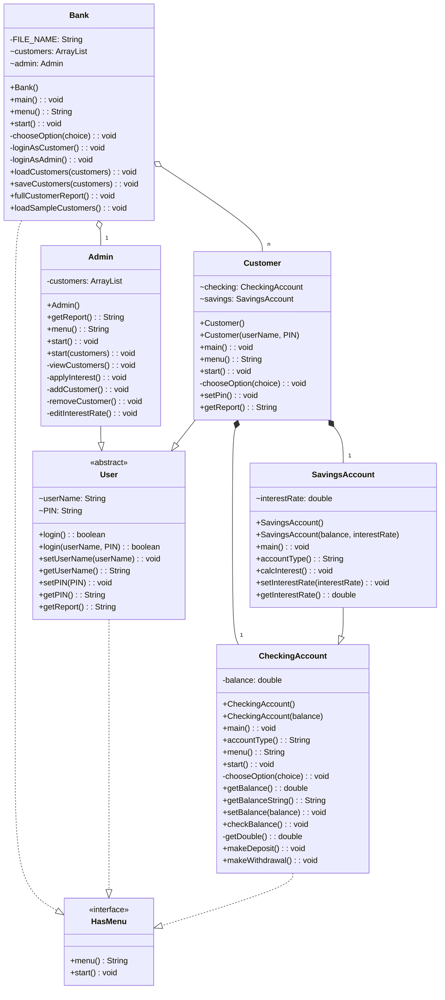

# Bank-On-It (complete)
11/6/2026

interface HasMenu
```
      String menu();
        Implemented by other classes.
    void start();
        Implemented by other classes. Classes that implement this interface must have menu() and start() methods.
```
public class CheckingAccount implements HasMenu, Serializable
```
  private double balance;   
  static final Scanner in;
      Shared Scanner used by every class for user input.
```

    CheckingAccount()
        Default constructor for the checking account class, sets the balance to 0.
    CheckingAccount(double balance)
        Overloaded constructor for the checking account class, creates a new checking account and sets the balance to the given value.
    main()
        Starts the program by calling Bank.main(), which opens the bank menu.
    String menu()
        Prints out the menu and gets a response from the user.
    void start()
        Runs the menu and calls the appropriate methods based on user input until the user chooses "Back".
    String accountType()
        Differentiates between savings/checking account.
    private void chooseOption(String choice)
        Handles the menu choices.
    double getBalance()
        Gets the balance of the account.
    String getBalanceString()
        Special method to get the balance as a string for printing (String.format).
    void setBalance(double balance)
        Sets the balance of the account.
    void checkBalance()
        Checks the balance of the account.
    private double getDouble()
        Reads as a double with exception handling. Returns 0 if the user enters invalid input.
    void makeDeposit()
        Makes a deposit into the account. Rejects amounts of 0 or less.
    void makeWithdrawal()
        Makes a withdrawal from the account. Rejects amounts of 0 or less, and amounts greater than the balance (insufficient funds).

class SavingsAccount extends CheckingAccount implements Serializable
```
Pretty much identical to CheckingAccount, but with an interest rate and a method to calculate interest.

    double interestRate;

    SavingsAccount()
        Default constructor for the savings account class, sets the balance to 0 and the interest rate to 0.02.
    SavingsAccount(double balance, double interestRate)
        Overloaded constructor for the savings account class, sets the balance and the interest rate to the given values.
    main()
        Starts the savings account menu directly, for testing.
    String accountType()
        Overrides CheckingAccount so the menu displays "Savings Account".
    void calcInterest()
        Calculates the interest based on the balance and interest rate and adds it to the balance. Package-private and not in the menu, so customers can't do this directly.
    void setInterestRate(double interestRate)
        Sets the interest rate. Doesn't allow negative interest rates (the rate is left unchanged).
    double getInterestRate()
        Gets the interest rate of the account.
```
abstract class User implements HasMenu, Serializable
```
       String userName;
        Username for the user.
    String PIN;
        PIN for the user.

    boolean login()
        Login method for the user, prompts for a username and PIN and returns true if they match, false otherwise. Also allows a new user to sign up using "none" for testing.
    boolean login(userName, PIN)
        Overloaded login method for the user, returns true if the username and PIN match, false otherwise.
    void setUserName(userName)
        Sets the username for the user.
    String getUserName()
        Gets the username for the user.
    void setPIN(PIN)
        Sets the PIN for the user.
    String getPIN()
        Gets the PIN for the user.
    abstract String getReport()
        Abstract method to get a report of the user's account(s).
```

class Customer extends User implements Serializable
```
       CheckingAccount checking;
    SavingsAccount savings;
        Each customer has a checking account and a savings account.

    void main()
        Main method for the customer class, creates a new customer ("antonio", "2222"), loops until login succeeds, and starts the menu.
    Customer()
        Default constructor for the customer class, creates a new customer with username "customer" and PIN "0000".
    Customer(userName, PIN)
        Overloaded constructor for the customer class, creates a new customer with the given username and PIN, a checking account and a savings account.
    String menu()
        Menu method for the customer class, prints out the menu and gets a response from the user.
    void start()
        Runs the customer menu until the customer logs out.
    private void chooseOption(String choice)
        Handles the menu choices: checking account, savings account, change PIN, account report, log out.
    void setPin()
        Changes the PIN for the customer, prompts the user for a new PIN and sets it. Doesn't accept an empty PIN.
    String getReport()
        Gets a report of the customer's account(s), returns a string with the username, account balances and savings interest rate.
```
class Bank implements HasMenu, Serializable
```
       private static final String FILE_NAME = "customers.ser";
        File used to save and load customer data.
    ArrayList<Customer> customers;
    Admin admin;
        A bank has a list of customers and an administrator.

    Bank()
        Default constructor for the bank class, creates an empty customer list and a new administrator.
    void main()
        Main method for the whole program, creates a bank, loads the customers, starts the bank menu, and saves the customers on exit.
    String menu()
        Prints out the bank menu (customer login, administrator login, exit) and gets a response from the user.
    void start()
        Runs the bank menu until the user chooses to exit.
    private void chooseOption(String choice)
        Handles the menu choices.
    private void loginAsCustomer()
        Prompts for a username and PIN, and starts the matching customer's menu. Prints a message if the login fails.
    private void loginAsAdmin()
        Prompts for an admin username and PIN, and starts the admin menu with the customer list. Prints a message if the login fails.
    void loadCustomers(ArrayList<Customer> customers)
        Loads customers from customers.ser. If the file doesn't exist yet, loads the sample customers instead. Warns the user if the file can't be read.
    void saveCustomers(ArrayList<Customer> customers)
        Saves the customers to customers.ser. Warns the user if the file can't be saved.
    void fullCustomerReport()
        Prints a report of every customer's balances and interest rate.
    void loadSampleCustomers()
        Loads the default sample customers (alice and bob) with starting balances and interest rates.
```
class Admin extends User implements Serializable
```
       private ArrayList<Customer> customers;
        The bank's customer list, passed in when the admin menu starts.

    Admin()
        Default constructor for the admin class, sets the username and PIN to "admin" (for testing purposes).
    String getReport()
        Gets a report of the administrator, returns a string with the admin username.
    String menu()
        Prints out the administrator menu and gets a response from the user.
    void start()
        Starts the admin menu using the current customer list.
    void start(ArrayList<Customer> customers)
        Sets the customer list and runs the admin menu until the admin exits.
    private void viewCustomers()
        Prints a report for every customer.
    private void applyInterest()
        Applies interest to every customer's savings account.
    private void addCustomer()
        Adds a new customer with a username and PIN. Doesn't allow empty or duplicate usernames, or empty PINs.
    private void removeCustomer()
        Removes a customer by username, after the admin confirms (y/n).
    private void editInterestRate()
        Edits a customer's savings interest rate. Only accepts a number of 0 or more, and asks the admin to confirm (y/n) before changing it.
```
