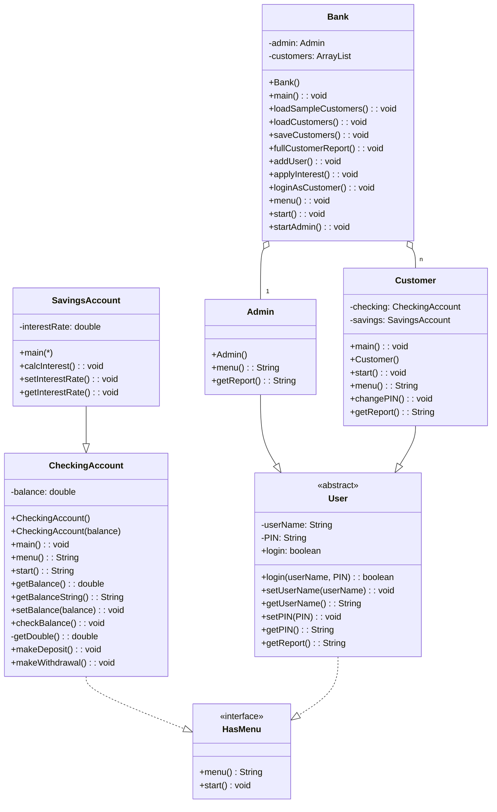

# Bank-On-It
11/6/2026



interface HasMenu 
```
      String menu();
        Implemented by other classes.
    void start();
        Implemented by other classes. Classes that implement this interface must have menu() and start() methods.
```

public class CheckingAccount implements HasMenu 
```
  private double balance;   
```
 

    CheckingAccount()
        Default constructor for the checking account class, sets the balance to 0.
    CheckingAccount(double balance)
        Overloaded constructor for the checking account class, creates a new checking account and sets the balance to the given value.
    main()
    String menu()
        Prints out the menu and gets a response from the user.
    void start()
        Runs the menu and calls the appropriate methods based on user input.
    String accountType()
        Differentiates between savings/checking account.
    void processChoice(String choice)
        Handles the menu choices.
    double getBalance()
        Gets the balance of the account.
    String getBalanceString()
        Special method to get the balance as a string for printing (String.format).
    void setBalance(double balance)
        Sets the balance of the account.
    void checkBalance()
        Checks the balance of the account.
    private double getDouble()
        Reads as a double with exception handling. Returns 0 if the user enters invalid input.
    void makeDeposit()
        Makes a deposit into the account.
    void makeWithdrawal()
        Makes a withdrawal from the account.
}

class SavingsAccount extends CheckingAccount 
```
Pretty much identical to CheckingAccount, but with an interest rate and a method to calculate interest.

    double interestRate;

    main()
    calcInterest()
        Calculates the interest based on the balance and interest rate and adds it to the balance. Doesn't allow negative interest rates, and doesn't allow customers to do this directly.
    void setInterestRate(double interestRate)
    double getInterestRate()
```

abstract class User implements HasMenu, Serializable 
```
       String userName;
        Username for the user.
    String PIN;
        PIN for the user.

    boolean login()
        Login method for the user, returns true if the username and PIN match, false otherwise. Also allows a new user to sign up using "none" for testing.
    boolean login(userName, PIN)
        Overloaded login method for the user, returns true if the username and PIN match, false otherwise.
    void setUserName(userName)
        Sets the username for the user.
    String getUserName()
        Gets the username for the user.
    void setPIN(PIN)
        Sets the PIN for the user.
    String getPIN()
        Gets the PIN for the user.
    abstract String getReport()
        Abstract method to get a report of the user's account(s).
```


class Customer extends User 
```
       CheckingAccount checking;
    SavingsAccount savings;
        Each customer has a checking account and a savings account.

    void main()
        Main method for the customer class, creates a new customer and starts the menu.
    Customer()
        Default constructor for the customer class, creates a new customer with a checking account and a savings account.
    Customer(userName, PIN)
        Overloaded constructor for the customer class, creates a new customer with a checking account and a savings account.
    String menu()
        Menu method for the customer class, prints out the menu and gets a response from the user.
    void changePin()
        Changes the PIN for the customer, prompts the user for a new PIN and sets it.
    String getReport()
        Gets a report of the customer's account(s), returns a string with the account balances and interest rate.
```

