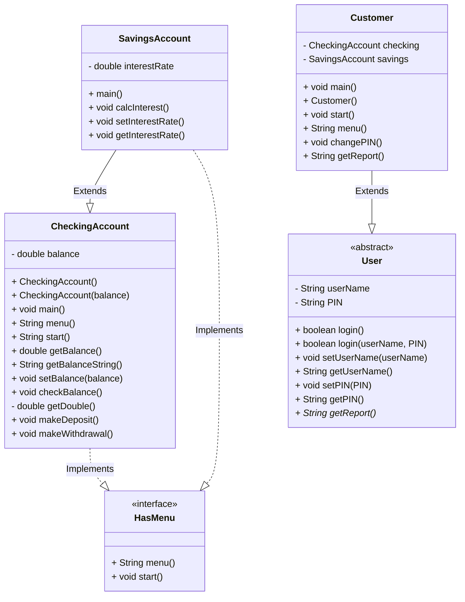

# Bank-On-It-1
11/6/2026



interface HasMenu 
```
    String menu();
    void start();

    // implemented by other classes
    // classes that implement this interface must have menu() and start() methods
```

public class CheckingAccount implements HasMenu 
```
    private double balance;
```
 

    CheckingAccount() // default constructor for the checking account class, sets the balance to 0.
    CheckingAccount(double balance) // overloaded constructor for the checking account class, creates a new checking account and sets the balance to the given value
    main()
    string menu()     // Menu prints out the menu and gets a response from the user.
    void start()    // Start method runs the menu and calls the appropriate methods based on user input.
    string accountType() // to differentiate between savings/checking account
    void processChoice(string choice) // Handles the menu choices
    double getBalance() // gets the balance of the account
    string getBalanceString() // special method to get the balance as a string for printing (String.format)
    void setBalance(double balance) // sets the balance of the account
    void checkBalance() // checks the balance of the account
    private double getDouble() // read as a double with exception handling. Return 0 if the user enters invalid input.
    void makeDeposit() // makes a deposit into the account
    void makeWithdrawal() // makes a withdrawal from the account
}

class SavingsAccount extends CheckingAccount 
```
    // pretty much identical to CheckingAccount, but with an interest rate and a method to calculate interest
    double interestRate;
    main()
    calcInterest() // calculates the interest based on the balance and interest rate and adds it to the balance, don't allow negative interest rates and don't allow customers do this directly.
    void setInterestRate(double interestRate)
    double getInterestRate()
```

abstract class User implements HasMenu, Serializable 
```
    String userName; // username for the user
    String PIN; // PIN for the user
    boolean login() // login method for the user, returns true if the username and PIN match, false otherwise. Also allows a new user to signup using "none" for testing
    boolean login(userName, PIN) // overloaded login method for the user, returns true if the username and PIN match, false otherwise
    void setUserName(userName) // sets the username for the user
    String getUserName() // gets the username for the user
    void setPIN(PIN) // sets the PIN for the user
    String getPIN() // gets the PIN for the user
    abstract String getReport() // abstract method to get a report of the user's account(s)
```


class Customer extends User 
```
    CheckingAccount checking; // each customer has a checking account and a savings account
    SavingsAccount savings;
    void main() // main method for the customer class, creates a new customer and starts the menu
    Customer() // default constructor for the customer class, creates a new customer with a checking account and a savings account
    Customer(usernName, PIN) // overloaded constructor for the customer class, creates a new customer with a checking account and a savings account
    string menu() // menu method for the customer class, prints out the menu and gets a response from the user
    void changePin() // method to change the PIN for the customer, prompts the user for a new PIN and sets it
    string getReport() // method to get a report of the customer's account(s), returns a string with the account balances and interest rate
```

